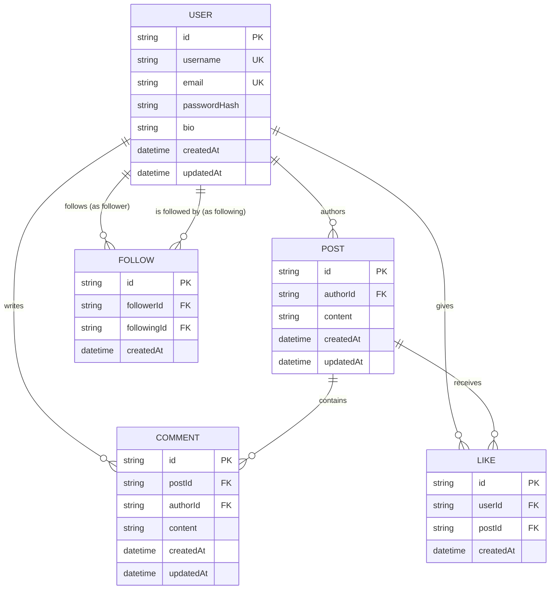

# Database Design Document — NovaConnect

**Project**: NovaConnect  
**ORM**: Prisma ORM  
**Engines Supported**: SQLite (Local Dev) / PostgreSQL (Production)  
**Date**: 2026-10-25  

---

## 1. Entity-Relationship (ER) Diagram



---

## 2. Relational Schema & Constraints

### 2.1 `User`
- **`id`**: String / UUID (Primary Key, unique identifier).
- **`username`**: String, `UNIQUE`, indexed. Case-insensitive constraint.
- **`email`**: String, `UNIQUE`, indexed. Normalized lowercase.
- **`passwordHash`**: String (bcrypt hash with 10 salt rounds).
- **`bio`**: String, nullable, max 160 characters. Default empty.
- **`createdAt`**: DateTime, default `now()`.
- **`updatedAt`**: DateTime, updated on change.

### 2.2 `Post`
- **`id`**: String / UUID (Primary Key).
- **`authorId`**: String (Foreign Key referencing `User.id`), indexed.
- **`content`**: String (1 - 500 characters).
- **`createdAt`**: DateTime, indexed (for fast reverse-chronological feed sorting `ORDER BY createdAt DESC`).
- **`updatedAt`**: DateTime.
- **Cascade**: `onDelete: Cascade` when User is removed.

### 2.3 `Like`
- **`id`**: String / UUID (Primary Key).
- **`userId`**: String (Foreign Key referencing `User.id`).
- **`postId`**: String (Foreign Key referencing `Post.id`).
- **`createdAt`**: DateTime, default `now()`.
- **Compound Unique Constraint**: `@@unique([userId, postId])` — Guarantees a user cannot like the same post more than once at the database level.
- **Cascades**:
  - `onDelete: Cascade` when Post is deleted.
  - `onDelete: Cascade` when User is deleted.

### 2.4 `Comment`
- **`id`**: String / UUID (Primary Key).
- **`postId`**: String (Foreign Key referencing `Post.id`), indexed.
- **`authorId`**: String (Foreign Key referencing `User.id`), indexed.
- **`content`**: String (1 - 300 characters).
- **`createdAt`**: DateTime, default `now()`.
- **`updatedAt`**: DateTime.
- **Cascades**:
  - `onDelete: Cascade` when Post is deleted.
  - `onDelete: Cascade` when User is deleted.

### 2.5 `Follow`
- **`id`**: String / UUID (Primary Key).
- **`followerId`**: String (Foreign Key referencing `User.id`).
- **`followingId`**: String (Foreign Key referencing `User.id`).
- **`createdAt`**: DateTime, default `now()`.
- **Compound Unique Constraint**: `@@unique([followerId, followingId])` — Prevents duplicate follow relations.
- **Self-Follow Guard**: Application layer rejects `followerId === followingId`.
- **Cascades**:
  - `onDelete: Cascade` when either User is deleted.

---

## 3. Prisma Schema Reference

```prisma
datasource db {
  provider = "sqlite" // Or "postgresql" via DATABASE_URL
  url      = env("DATABASE_URL")
}

generator client {
  provider = "prisma-client-js"
}

model User {
  id           String    @id @default(uuid())
  username     String    @unique
  email        String    @unique
  passwordHash String
  bio          String?   @default("")
  createdAt    DateTime  @default(now())
  updatedAt    DateTime  @updatedAt

  posts        Post[]
  comments     Comment[]
  likes        Like[]

  // Self-referential Many-to-Many via explicit Follow model
  following    Follow[]  @relation("UserFollows")
  followers    Follow[]  @relation("UserFollowers")
}

model Post {
  id        String    @id @default(uuid())
  content   String
  createdAt DateTime  @default(now())
  updatedAt DateTime  @updatedAt

  authorId  String
  author    User      @relation(fields: [authorId], references: [id], onDelete: Cascade)

  comments  Comment[]
  likes     Like[]

  @@index([createdAt])
  @@index([authorId])
}

model Comment {
  id        String    @id @default(uuid())
  content   String
  createdAt DateTime  @default(now())
  updatedAt DateTime  @updatedAt

  postId    String
  post      Post      @relation(fields: [postId], references: [id], onDelete: Cascade)

  authorId  String
  author    User      @relation(fields: [authorId], references: [id], onDelete: Cascade)

  @@index([postId])
  @@index([authorId])
}

model Like {
  id        String   @id @default(uuid())
  createdAt DateTime @default(now())

  userId    String
  user      User     @relation(fields: [userId], references: [id], onDelete: Cascade)

  postId    String
  post      Post     @relation(fields: [postId], references: [id], onDelete: Cascade)

  @@unique([userId, postId])
}

model Follow {
  id          String   @id @default(uuid())
  createdAt   DateTime @default(now())

  followerId  String
  follower    User     @relation("UserFollows", fields: [followerId], references: [id], onDelete: Cascade)

  followingId String
  following   User     @relation("UserFollowers", fields: [followingId], references: [id], onDelete: Cascade)

  @@unique([followerId, followingId])
}
```

---

## 4. Deletion Cascade Impact Analysis

| Action | Impact on Related Data | Reason |
| :--- | :--- | :--- |
| **Delete User** | Deletes user's Posts, Comments, Likes, and Follow edges. | Prevents broken author/follower references in queries. |
| **Delete Post** | Deletes all associated Likes and Comments. | Comments and likes cannot exist without a target post. |
| **Delete Comment** | Only the single comment record is removed. Post comment count decrements naturally. | Clean atomic removal. |
| **Unlike Post** | Single `Like` row is deleted. Post like count decrements naturally. | Atomic removal. |
| **Unfollow User** | Single `Follow` row is deleted. Follower/following counts decrement naturally. | Atomic removal. |
