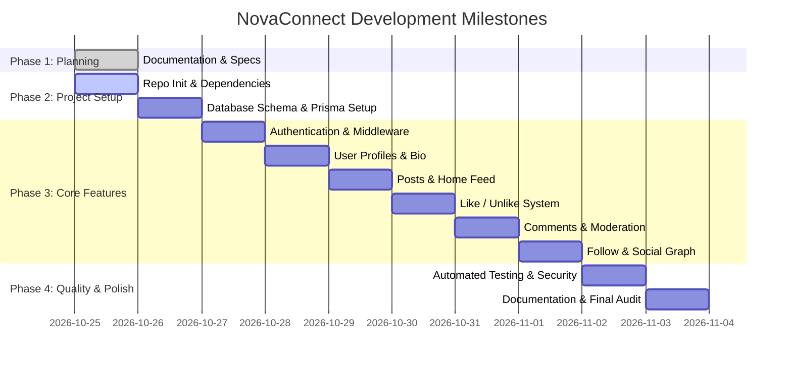

# Implementation Plan & Mentorship Roadmap — NovaConnect

**Project**: NovaConnect (CodeAlpha Task 2)  
**Methodology**: Human-Led, Mentor-Guided Incremental Development  
**Date**: 2026-10-25  

---

## 1. Guiding Principles
Under CodeAlpha's internship policy:
- **No autonomous monolithic code generation**: Sachin writes and understands each component.
- **Architectural mentorship**: Antigravity provides step-by-step checklists, pseudocode, data structures, and reviews.
- **Incremental verification**: Every phase must be tested and verified before starting the next phase.

---

## 2. Implementation Roadmap

---

## 3. Step-by-Step Feature Checklists

### Milestone 1: Project Setup & Database Foundations
- [ ] Initialize Git repository: `git init`
- [ ] Create `.gitignore` for Node.js (`node_modules`, `.env`, `*.db`, `*.db-journal`)
- [ ] Initialize `package.json` with Express, Prisma, bcryptjs, jsonwebtoken, cors, dotenv
- [ ] Initialize Prisma with SQLite/PostgreSQL datasource in `prisma/schema.prisma`
- [ ] Run initial migration to create User, Post, Comment, Like, Follow tables

### Milestone 2: Authentication (AUTH-001, AUTH-002)
- [ ] Build `backend/controllers/authController.js` (register, login, me)
- [ ] Build `backend/middleware/authMiddleware.js` (JWT verification)
- [ ] Build client auth form (`frontend/index.html`) with toggle between Login and Sign Up
- [ ] Build `frontend/js/auth.js` handling form submission and JWT storage in `localStorage`
- [ ] **Verification**: Successfully register user, login, receive token, access `/api/auth/me`.

### Milestone 3: User Profiles (PROF-001, PROF-002)
- [ ] Build `backend/controllers/userController.js` (`getUserProfile`, `updateBio`)
- [ ] Build `frontend/profile.html` displaying avatar placeholder, username, bio, stats
- [ ] Build `frontend/js/profile.js` loading user data and submitting bio edits
- [ ] **Verification**: Profile displays correct counts; bio updates persist.

### Milestone 4: Posts & Feed (POST-001, POST-002, POST-003, FEED-001)
- [ ] Build `backend/controllers/postController.js` (`createPost`, `getFeed`, `editPost`, `deletePost`)
- [ ] Implement ownership authorization middleware in `postRoutes.js`
- [ ] Build `frontend/feed.html` with post creation textarea and posts stream
- [ ] Build `frontend/js/feed.js` to render posts chronologically
- [ ] **Verification**: Create post, view in feed, edit own post, attempt edit of other user's post (expect 403), delete own post.

### Milestone 5: Likes System (LIKE-001)
- [ ] Build `backend/controllers/likeController.js` (`toggleLike`)
- [ ] Implement Prisma upsert/transaction with `@@unique([userId, postId])`
- [ ] Add heart icon button with dynamic like counter in post card UI
- [ ] **Verification**: Click like increments count; clicking again decrements count; concurrent clicks cannot duplicate.

### Milestone 6: Comments System (COMM-001, COMM-002)
- [ ] Build `backend/controllers/commentController.js` (`addComment`, `getComments`, `deleteComment`)
- [ ] Enforce deletion permission (comment author OR post author)
- [ ] Add collapsible comment section under each post card in feed
- [ ] **Verification**: Add comment, view comment list, delete authorized comment.

### Milestone 7: Follow System (FOLLOW-001, FOLLOW-002)
- [ ] Build `backend/controllers/userController.js` follow methods (`toggleFollow`, `getFollowers`, `getFollowing`)
- [ ] Enforce self-follow rejection (`followerId !== followingId`)
- [ ] Add Follow/Unfollow button on user profiles
- [ ] **Verification**: Follow user, verify follower count increases, verify following feed filters correctly.

### Milestone 8: Testing, Security Audit & Documentation
- [ ] Write integration test suites in `tests/`
- [ ] Perform security review against OWASP Top 10 checklist in `docs/SECURITY.md`
- [ ] Create production-ready `README.md` with architectural diagrams and setup instructions
- [ ] Generate `docs/FINAL_AUDIT.md` verifying all P0 requirements
