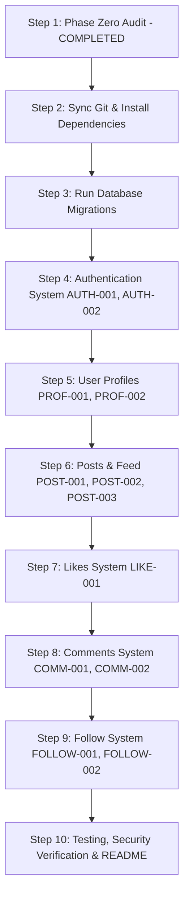

# Repository Audit: NovaConnect (CodeAlpha Social Media Platform)

**Date**: 2026-10-25  
**Auditor**: Antigravity (Senior Software Architect & Mentor)  
**Workspace**: `c:\Users\kalin\.gemini\antigravity-ide\scratch\CodeAlpha_SocialMediaPlatform`  
**Repository Remote**: `https://github.com/Sachinxcode-01/CodeAlpha_SocialMediaPlatform.git`  
**Task**: CodeAlpha Full Stack Development Internship - Task 2: Social Media Platform  

---

## 1. Executive Summary

This repository audit represents **Phase Zero** of the CodeAlpha Social Media Platform project. A thorough inspection of the workspace, remote repository, and host environment was performed prior to making any architectural modifications or application code changes.

### Key Findings
- **Git Repository & Remote**: Local `.git` exists on branch `master` (no local commits yet). The remote repository `https://github.com/Sachinxcode-01/CodeAlpha_SocialMediaPlatform.git` is **verified and reachable**. It contains branch `origin/main` with initial commit `253d4870db972942156cff827728004b52984c80` containing an initial `README.md`.
- **Project Configuration**: `package.json`, `.gitignore`, `.env.example`, and `.env` are present. Dependencies specified include Express.js (`^4.21.2`), Prisma ORM (`^6.4.1`), `bcryptjs`, `jsonwebtoken`, `cors`, and `dotenv`. Dependencies in `node_modules` are not yet installed.
- **Database Schema**: `prisma/schema.prisma` is created and defines SQLite datasource with relational models: `User`, `Post`, `Comment`, `Like`, and `Follow`. Migrations have not yet been executed (`dev.db` does not exist).
- **Architecture & Specifications**: Comprehensive documentation suite established in `docs/` (`PRD.md`, `TRD.md`, `API.md`, `DATABASE.md`, `SECURITY.md`, `TESTING.md`, `IMPLEMENTATION_PLAN.md`, `DECISIONS.md`).
- **Application Code & Tests**: Application code (`backend/`, `frontend/`, and `tests/`) is not yet implemented. Executing `npm test` runs Node test runner (`node --test tests/*.test.js`) and reports 0 tests cleanly.

---

## 2. Environment & Tooling Verification

| Component | Target/Required | Detected / Status | Verification Command | Notes |
| :--- | :--- | :--- | :--- | :--- |
| **Local Workspace** | `CodeAlpha_SocialMediaPlatform` | Directory Present | `Get-ChildItem -Force` | Workspace verified |
| **Local Git Repo** | Initialized `.git` | `True` (Branch: `master`) | `git status` | Untracked files present, 0 local commits |
| **Remote Git** | `Sachinxcode-01/...` | `Verified & Accessible` | `git fetch origin` | `origin/main` present (commit `253d487`) |
| **Node.js** | >= 18.x | **v25.1.0** | `node -v` | Ready for Express.js |
| **npm** | >= 9.x | **11.14.1** | `npm -v` | Ready for dependency installation |
| **Python** | 3.x | **3.10.11** | `python --version` | Available if Django were selected |
| **Database Engine**| PostgreSQL / SQLite | **SQLite via Prisma** | Verified in `schema.prisma` | Zero-configuration local database |
| **Test Runner** | Native Node Test Runner | **Available** | `npm test` | Verified: exits 0 with 0 tests |

---

## 3. Existing Project Structure

```
CodeAlpha_SocialMediaPlatform/
├── .env                  # Local environment configuration (ignored by Git)
├── .env.example          # Template environment file
├── .git/                 # Local Git repository
├── .gitignore            # Git exclusion rules (node_modules, .env, *.db)
├── docs/                 # Documentation suite
│   ├── API.md            # REST API endpoint contracts
│   ├── DATABASE.md       # Relational schema & indexing documentation
│   ├── DECISIONS.md      # Architecture Decision Records (ADRs)
│   ├── IMPLEMENTATION_PLAN.md # Phased implementation guide
│   ├── PRD.md            # Product Requirements Document
│   ├── REPOSITORY_AUDIT.md    # This Phase Zero audit report
│   ├── SECURITY.md       # Threat model and security controls
│   ├── TESTING.md        # Test matrix and test cases
│   └── TRD.md            # Technical Requirements Document
├── package.json          # Node.js project manifest & scripts
└── prisma/
    └── schema.prisma     # Prisma data models (User, Post, Comment, Like, Follow)
```

- **Frontend framework/files**: Not yet implemented (`frontend/` to be scaffolded with HTML5, CSS3, Vanilla JS).
- **Backend framework/files**: Not yet implemented (`backend/server.js`, routes, controllers, middleware).
- **Database migrations**: Pending `npx prisma migrate dev`.
- **Test suites**: Pending creation in `tests/`.

---

## 4. Feature Completion Matrix

| Requirement ID | Feature Description | CodeAlpha Priority | Current Status | Evidence / Notes |
| :--- | :--- | :--- | :--- | :--- |
| **AUTH-001** | User Registration | P0 | **PENDING IMPLEMENTATION** | Data model drafted; endpoints and UI pending |
| **AUTH-002** | Login & Logout (Session/JWT) | P0 | **PENDING IMPLEMENTATION** | JWT architecture planned; middleware and UI pending |
| **PROF-001** | View User Profile | P0 | **PENDING IMPLEMENTATION** | Schema drafted; profile API & UI pending |
| **PROF-002** | Edit Profile Information | P0 | **PENDING IMPLEMENTATION** | Bio/profile fields planned; mutation API & UI pending |
| **POST-001** | Create Post | P0 | **PENDING IMPLEMENTATION** | Post model drafted; create endpoint & form pending |
| **POST-002** | Display Post Feed | P0 | **PENDING IMPLEMENTATION** | Chronological feed planned; retrieval query & UI pending |
| **POST-003** | Edit & Delete Owned Post | P0 | **PENDING IMPLEMENTATION** | Ownership authorization logic pending |
| **LIKE-001** | Like and Unlike Post | P0 | **PENDING IMPLEMENTATION** | Unique `[userId, postId]` constraint drafted; API pending |
| **COMM-001** | Add Comment to Post | P0 | **PENDING IMPLEMENTATION** | Comment model drafted; API & form pending |
| **COMM-002** | Delete Authorized Comment | P0 | **PENDING IMPLEMENTATION** | Author/post-owner deletion logic pending |
| **FOLLOW-001**| Follow and Unfollow User | P0 | **PENDING IMPLEMENTATION** | Unique `[followerId, followingId]` relation drafted |
| **FOLLOW-002**| View Followers & Following | P0 | **PENDING IMPLEMENTATION** | Relation query endpoints & modal/lists pending |
| **FEED-001** | Chronological / Filtered Feed | P0 | **PENDING IMPLEMENTATION** | Feed aggregation logic pending |

---

## 5. Security & Technical Debt Audit

1. **Dependency Installation**: `npm install` needs to be run to install Express, Prisma, bcryptjs, jsonwebtoken, etc., and generate Prisma client.
2. **Branch Alignment**: Local branch is `master`, while remote default branch is `main`. We should align local branch to `main` and track `origin/main`.
3. **Database Selection**: SQLite via Prisma is configured in `prisma/schema.prisma` and `.env`. This provides reliable, portable local development without external daemon requirements. If PostgreSQL is required later for production deployment, Prisma makes provider switching seamless.
4. **Password Security**: Passwords must be hashed using `bcryptjs` with salt rounds >= 10. `User.passwordHash` must never be selected or returned in any API responses.
5. **XSS & Input Sanitization**: Post and comment contents must be sanitized and rendered using safe DOM properties (`textContent`) rather than `innerHTML`.
6. **Strict Server-Side Authorization**: Editing/deleting posts and comments must verify `req.user.id === resource.authorId` on the server before mutating database records.

---

## 6. Recommended Development Sequence



1. **Step 1 (Current)**: Present Phase Zero audit report and obtain user approval.
2. **Step 2**: Align local git branch to `main`, install dependencies (`npm install`), and verify Prisma client generation.
3. **Step 3**: Execute Prisma migration to create `prisma/dev.db`.
4. **Step 4**: Guide user through implementing each feature step-by-step with architectural explanations, pseudocode, implementation checklists, and review.
