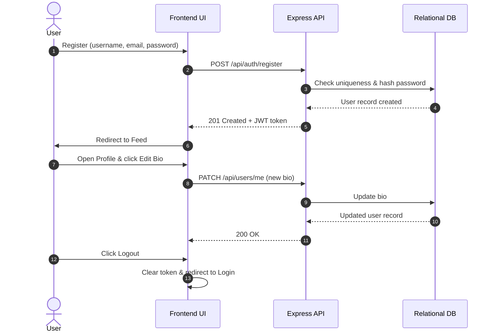
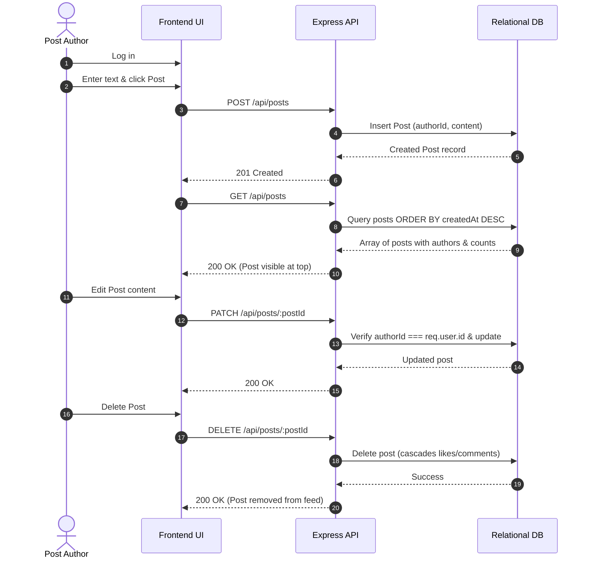

# Testing Strategy & Verification Plan — NovaConnect

**Project**: NovaConnect  
**Organization**: CodeAlpha Full Stack Development Internship  
**Date**: 2026-10-25  

---

## 1. Testing Framework & Philosophy

Testing for NovaConnect spans four complementary levels:
1. **Unit Testing**: Testing individual utility functions, password hashing, and token validation.
2. **API Integration Testing**: Testing Express REST endpoints using an automated test runner (e.g., Jest/Supertest or Node.js native test runner `node:test`).
3. **Database Constraint Testing**: Validating relational cascades and unique compound constraints in Prisma.
4. **End-to-End User Workflows**: Validating browser-level user journeys from registration through social interaction.

---

## 2. Core Internship Workflows

### Workflow A: User Lifecycle & Profile Management

- **Test Criteria**:
  - `POST /api/auth/register` creates user with bcrypt hash.
  - Duplicate email/username registration fails with `409 Conflict`.
  - Profile update succeeds for authenticated owner.
  - Token is cleared on logout; subsequent calls to `/api/auth/me` fail with `401 Unauthorized`.

---

### Workflow B: Post Authoring, Feed & Ownership

---

### Workflow C: Multi-User Social Graph & Interactions
1. **User A** logs in and authors Post P1.
2. **User B** logs in:
   - Likes Post P1 (`POST /api/posts/P1/likes`). Verify like count becomes `1`.
   - Posts a comment on P1 (`POST /api/posts/P1/comments`): *"Great platform!"*. Verify comment count becomes `1`.
   - Follows User A (`POST /api/users/usr_A/follow`). Verify User A's follower count becomes `1`, and User B's following count becomes `1`.
3. Verify that User A's profile dynamically reflects:
   - Follower count = 1
   - Post count = 1

---

### Workflow D: Security & Unauthorized Operation Guards
- **D1: Unauthorized Post Edit**:
  - User B attempts `PATCH /api/posts/P1` (owned by User A).
  - Expected: `403 Forbidden` (`{"error": "Unauthorized to modify this post"}`).
- **D2: Unauthorized Post Delete**:
  - User B attempts `DELETE /api/posts/P1`.
  - Expected: `403 Forbidden`.
- **D3: Duplicate Like Prevention**:
  - User B sends two simultaneous `POST /api/posts/P1/likes` requests.
  - Expected: Like toggles to true, second toggle unlikes; database never creates duplicate like records.
- **D4: Self-Follow Guard**:
  - User A attempts `POST /api/users/usr_A/follow`.
  - Expected: `400 Bad Request` (`{"error": "Users cannot follow themselves"}`).
- **D5: Unauthenticated Access**:
  - Request to `POST /api/posts` with no Authorization header.
  - Expected: `401 Unauthorized`.

---

## 3. Test Execution Commands & Verification

| Test Suite | Purpose | Execution Command | Target Pass Rate |
| :--- | :--- | :--- | :--- |
| **Auth Test Suite** | Registration, validation, duplicate rejection, login, JWT issuance | `npm test -- auth.test.js` | 100% |
| **Posts Test Suite** | Create post, feed sorting, edit ownership, delete cascade | `npm test -- posts.test.js` | 100% |
| **Interactions Suite** | Like toggle, comment create, comment delete rules | `npm test -- interactions.test.js` | 100% |
| **Follow Suite** | Follow toggle, follower/following counts, self-follow guard | `npm test -- follow.test.js` | 100% |
| **Full Regression** | Run complete end-to-end test suite | `npm test` | 100% |
